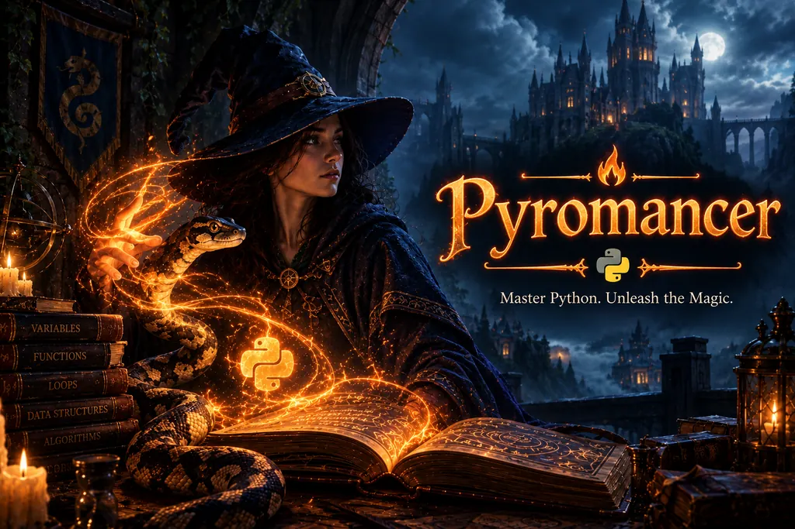

# 🔥 Pyromancer

*Master Python. Unleash the Magic.*



**Pyromancer** is a story-driven browser game in which students become wizards by writing
**real Python**. Every spell is Python code: to make "Hello world" magically appear on the
page, you cast `print("Hello world")`. Spells are checked by *trials* (automated tests),
mistakes are explained in plain language, and the journey runs from a first `print()` all
the way to **dynamic programming**.

* **No installation, no accounts.** Python runs inside the browser (via [Pyodide](https://pyodide.org)).
* **Easy to use in a course** — post a link in Blackboard (or any LMS). Optional extras:
  embed it in a page, hand out a single HTML file, or upload a **SCORM package** that
  stores progress in the LMS and sends a score to the gradebook.
* **Progress saves automatically**, and students can carry it between computers with a
  *Save Scroll*.

---

## What students learn

| Chapter | Location | Topics | Difficulty |
|---|---|---|---|
| 1 | 🏰 The Apprentice's Tower | `print`, strings, variables, arithmetic, f-strings, `input()`, `len()` | 🌱 Easy |
| 2 | 🚪 The Hall of Forking Paths | booleans, `if/elif/else`, `while`, `for`/`range`, `break`/`continue` | 🌱 Easy → 🔥 Medium |
| 3 | 🔮 The Summoning Circle | functions, parameters, `return`, default arguments, first recursion | 🌱 Easy → 🔥 Medium |
| 4 | 📚 The Library of Infinite Shelves | lists, tuples, dictionaries, sets, comprehensions, sorting with `key` | 🌱 Easy → 🐉 Hard |
| 5 | 🗿 The Golem Workshop | classes, objects, methods, inheritance, polymorphism, exceptions, magic methods | 🔥 Medium → 🐉 Hard |
| 6 | 🌀 The Labyrinth of Echoes | recursion, stacks, queues, linked lists, binary search, merge sort, BFS, Big-O | 🔥 Medium → 🐉 Hard |
| 7 | 🐉 The Hydra's Lair | dynamic programming: memoization, tabulation, coins, grids, LCS, knapsack, edit distance | 🐉 Hard |

Every challenge is labelled **Easy**, **Medium** or **Hard**. Each one has a short story, a
precise task, a *Spell Scroll* lesson that teaches the concept, three progressive hints from
Pip the owl, and trials that check the spell.

---

## Playing

**Online:** `https://jeffhaines20.github.io/Educational-Games/pyromancer/`
(once the site is published — see *For instructors* below).

**From a file:** download [`dist/pyromancer.html`](dist/pyromancer.html) and double-click it.

**Requirements:** a current Chrome, Edge, Firefox or Safari, and internet access to
`cdn.jsdelivr.net` (the Python engine: about 12 MB on the first visit, then cached). The code
editor (`cdnjs.cloudflare.com`) and fonts (Google Fonts) are optional — if they're blocked the
game uses a plain editor and system fonts.

### How a challenge works

1. Read the story and **Your Task**. Open the **Spell Scroll** to learn what you need.
2. Write your spell in the editor and press **✨ Cast Spell** (or **Ctrl/⌘ + Enter**).
3. The **Scrying Pool** shows what your spell printed. If something went wrong you see a
   friendly explanation *and* Python's real error message, and the line is highlighted.
4. The **Trials** — automatic checks of your spell — show what passed. Pass them all to master it.

**Stars:** ★★★ without hints, ★★ with one hint, ★ with more hints. After three unsuccessful
casts you may read the *Answer Scroll* (worth ★). **XP** and **wizard ranks** (Novice →
Archmage) grow as you master spells. Finish every spell in a chapter to unlock the next. The
**Practice Chamber** is a free sandbox, and the **Grimoire** keeps every spell you've mastered.

---

## Saving progress

* Progress is saved **automatically in the browser** you play in (on that computer).
* To move to another computer, or as a backup, open **Save Scroll**: download a save file or
  copy the save code (a long line of text), then choose **Import Save Scroll** on the other
  computer.
* Shared computers: there are three save slots — one per student.
* **Private/incognito windows** keep progress only until the window is closed, and the game
  can't tell — export a Save Scroll before closing.
* A copy **embedded** in an LMS page and the same game opened from a **link** keep *separate*
  progress (browsers keep embedded sites' storage apart). Use one way per course.
* With the **SCORM package**, the LMS stores stars, hints and unlocks, so progress follows the
  student to any computer; the code they typed stays in the browser where they typed it.

---

## For instructors

### Recommended: post a link (simplest)

1. **Publish the game with GitHub Pages** (one time):
   * The repository must be **public** for free GitHub Pages: on GitHub open
     **Settings → General → Danger Zone → Change visibility → Public**. (A private repository
     needs a paid GitHub plan for Pages — or use a free host such as Cloudflare Pages or
     Netlify, which can publish from a private repository.) The game's code — including the
     reference solutions shown in the Answer Scroll — is visible in any browser anyway.
   * Make sure the game is on the **main** branch (merge the pull request that adds it).
   * **Settings → Pages → Build and deployment → Deploy from a branch → `main` / `(root)` →
     Save.** After a minute or two the game is live at
     `https://jeffhaines20.github.io/Educational-Games/pyromancer/`
     (and a menu of all games at `https://jeffhaines20.github.io/Educational-Games/`).
2. **Add the link to your course:**
   * **Blackboard Ultra:** Course Content → **+** → **Create** → **Link** → paste the address →
     give it a name ("Pyromancer — Python game") → Save. Students open it in a new tab.
   * **Blackboard Original:** a Content Area → **Build Content → Web Link** → paste the
     address → choose *Open in New Window: Yes* → Submit.
   * **Canvas / Moodle / D2L:** add a web link / URL resource the same way.
3. **Updates are automatic:** when the repository changes, the site updates within minutes and
   students keep their progress.

**Tracking progress with a link:** students open **Grimoire → Progress Report** and print it or
save it as a PDF to submit (an honour-system record of the spells mastered and stars earned).
If you want scores to arrive in the gradebook automatically, use the SCORM package instead.

### Optional: SCORM package (progress stored in the LMS + a gradebook score)

Upload [`dist/pyromancer-scorm.zip`](dist/pyromancer-scorm.zip) as a SCORM 1.2 package. The
package reports **score = percentage of spells mastered** (including spells finished with the
Answer Scroll — treat it as a completion/participation measure) and status
*incomplete* → *completed* at 100 %.

* **Blackboard Original:** Content Area → **Build Content → Content Package (SCORM)** → upload
  the zip → Submit; in the settings choose **Grade SCORM: Score**, *Points possible* 100.
* **Blackboard Ultra:** Course Content → **+** → **Create → SCORM package** (on some versions
  **+ → Upload** recognises the zip as SCORM) → open its settings and set grading to use the
  SCORM score, maximum 100. Check the result appears in the Gradebook after a test attempt.
* **Moodle:** Add an activity → **SCORM package** → upload the zip; *Grading method* **Highest
  grade**, *Maximum grade* 100; *Attempts management → Force new attempt* **No**.
* **D2L Brightspace:** Content → **Upload/Create → Add SCORM/xAPI** (wording varies by version),
  then link the SCORM object to a grade item.
* **Canvas:** needs your institution's SCORM tool (ask your Canvas admin); otherwise post a link.

Things to know:
* After changing the game you must **re-upload** the package (and the LMS may treat it as a
  new attempt).
* URL parameters (below) can't be passed to an uploaded package. To build a package without the
  Answer Scroll, run `python3 tools/build.py --answers off`.
* If the package can't reach the LMS (e.g. it was opened outside the course), the game shows a
  warning that the score isn't being recorded — students should reopen it from the course.
* Importing save codes is turned off inside the SCORM package, so scores can't be copied.

### Optional: embed it in a page

In a content area that accepts HTML (a Blackboard Original *Item* via the HTML source
button, an HTML block in a Blackboard Ultra *Document*, a Canvas *Page*, a Moodle *Page*):

```html
<iframe src="https://jeffhaines20.github.io/Educational-Games/pyromancer/"
        title="Pyromancer" width="100%" height="900"
        style="border:0" allow="clipboard-write"></iframe>
```

Some LMSs sandbox embedded frames so tightly that the browser blocks saving — the game says so.
Remember that embedded and linked copies keep separate progress.

### Optional: one HTML file

Upload [`dist/pyromancer.html`](dist/pyromancer.html) as a file. Depending on the LMS, students
either play it in the browser or download it and open it; progress is saved in that browser.

### Customising

For the link and embed options, add these to the game's address:

| Parameter | Effect |
|---|---|
| `?unlock=all` | Free practice: every chapter and challenge is open. |
| `?answers=off` | Hide the Answer Scroll (no reference solutions). |
| `?editor=plain` | A plain text box instead of the highlighting code editor (simpler for screen readers; avoids loading the editor from cdnjs). |
| `?sound=off` | Start with sound effects off. |

They can be combined: `…/pyromancer/?unlock=all&answers=off`. They don't apply to an uploaded
SCORM package or HTML file. Defaults live in [`js/config.js`](js/config.js).

### Troubleshooting

* **The Python engine never loads:** the browser must reach `cdn.jsdelivr.net` (with
  `unpkg.com` as a fallback). Some school networks block CDNs — ask IT to allow these hosts:
  `cdn.jsdelivr.net`, `unpkg.com`, `cdnjs.cloudflare.com`, `fonts.googleapis.com`,
  `fonts.gstatic.com`.
* **Sites with a Content-Security-Policy** (some LMS portals) must allow scripts and connections
  to those hosts, `'wasm-unsafe-eval'` (WebAssembly), and `worker-src blob: data:` (Python runs in
  a Web Worker). The single-file and SCORM builds also need `'unsafe-inline'` for `script-src`
  and `style-src`, because everything is inlined.
* **"Saving is blocked" warning:** tightly sandboxed frames can't keep data. Use the Save Scroll,
  or open the game in its own tab.
* **A spell "ran too long":** spells stop after about 2 million steps (or 8 seconds), so a loop
  that never ends can't freeze the page. Check the highlighted line.
* **No score in the gradebook (SCORM):** check the activity's grading settings (above), and that
  students launch it from the course rather than a bookmark.

### Hosting your own copy

Fork this repository on GitHub (if it isn't yours), make your fork public, and enable Pages as
above. Your copy appears at `https://<your-username>.github.io/<repository-name>/pyromancer/`.
Any static web host also works — just upload this folder.

### Privacy and accessibility

No accounts, analytics or tracking: nothing a student types is sent anywhere (except the progress
an LMS stores through SCORM). The browser downloads the Python engine, editor and fonts from public
CDNs, so those services see students' IP addresses (as with any web page using them). Progress is
kept in the browser's local storage, so on shared computers each student should use their own slot.

The game is keyboard-playable (in the code editor, **Tab** indents; press **Esc** then **Tab** to
move on), respects *reduce motion* settings, and is designed for readable contrast.

---

## For developers

Everything is plain HTML, CSS and JavaScript — no build step is needed to play.

```
index.html            the game
assets/               title art (originals in assets/source/)
css/style.css         styles
js/config.js          settings (CDN URLs, time limits, answer scroll…)
js/engine/            Python runner (Pyodide in a Web Worker), trial harness, saving, SCORM, progress rules
js/content/           the story and one file per chapter of challenges
js/ui/                screens, editor, rich text, effects, sounds
tools/                validators, dev server, build script, browser tests
docs/DESIGN.md        architecture, content format and authoring guide
dist/                 ready-made single-file and SCORM builds
```

* **Add or edit a challenge:** follow [docs/DESIGN.md](docs/DESIGN.md) §7, then run
  `python3 tools/validate_content.py` (checks every solution passes, every starter and
  known-wrong answer fails). Try any attempt with
  `python3 tools/try_spell.py <challenge-id> attempt.py`. `node tools/validate_pyodide.js`
  repeats the checks in the browser's own Python engine.
* **Run locally:** `bash tools/fetch_pyodide.sh` (once), `node tools/dev_server.js 8000`, then
  open `http://localhost:8000/?localPyodide=1`.
* **Rebuild the bundles:** `python3 tools/build.py` (writes `dist/`; `--answers off` for a
  package without the Answer Scroll).
* **Tests:** `node tools/test_engine.js`, then the browser suites in `tools/e2e/`
  (`engine-runner.js`, `engine-bundle.js`, `ui-flow.js`, `ui-robustness.js`).

Requires Node.js 18+ and Python 3.10+ for the tools; Playwright for the browser tests.

### Credits

Python in the browser by [Pyodide](https://pyodide.org) (MPL-2.0). Code editor by
[CodeMirror 5](https://codemirror.net/5/) (MIT). Fonts from Google Fonts (OFL). Title art supplied
by the project owner (`assets/source/`).
